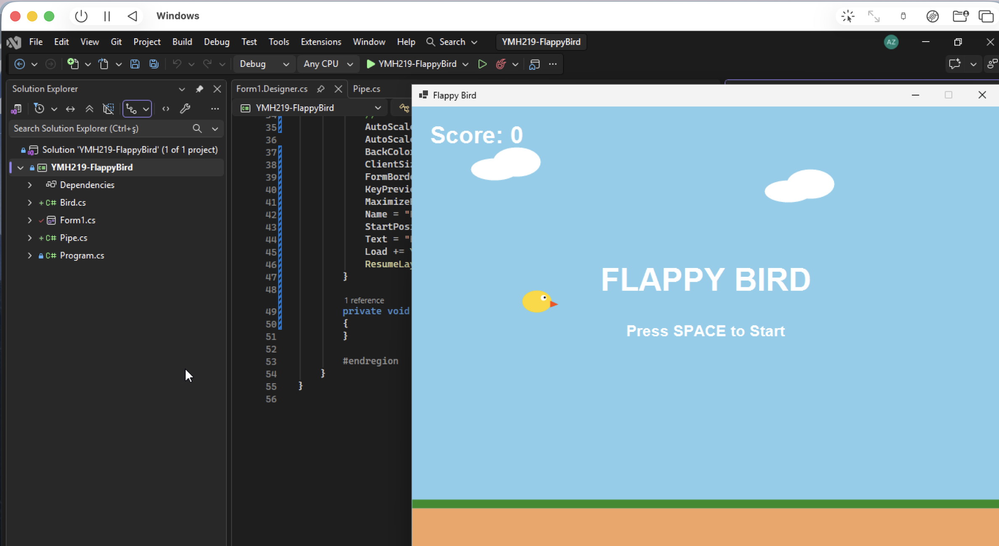
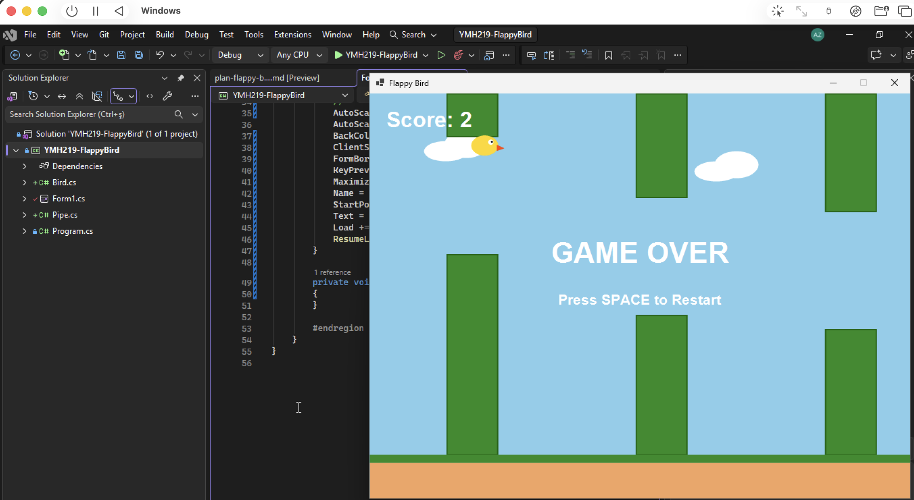

# 🐦 YMH219 - Flappy Bird

## 📸 Ekran Görüntüleri

### Oyun Ekranı (Gameplay)



### Oyun Sonu Ekranı (Game Over)




**Nesne Tabanlı Programlama (YMH 219)** dersi kapsamında C# ve Windows Forms kullanılarak geliştirilen Flappy Bird benzeri masaüstü oyunudur.

Oyuncu, klavyedeki `Space` tuşunu kullanarak yer çekimine karşı kuşu havada tutar ve borulara çarpmadan engellerin arasından geçerek en yüksek skoru elde etmeye çalışır. Proje kapsamında nesne tabanlı programlama (OOP), klavye olayları (Event Handling), zamanlayıcı (Timer), hareket fiziği ve çarpışma kontrolü gibi temel kavramlar uygulanmıştır.

---

## 🛠️ Kullanılan Teknolojiler ve NuGet Paketleri

* **Programlama Dili:** C#
* **Platform & Framework:** .NET 10 / Windows Forms (WinForms)
* **Grafik ve Çizim:** `System.Drawing` (Kuş, borular, bulutlar ve oyun ortamının çizimi için)
* **Oyun Döngüsü:** Windows Forms `Timer`
* **Geliştirme Ortamı (IDE):** Visual Studio Community 2026
* **Sürüm Kontrolü:** Git & GitHub
* **NuGet Paketleri:** Harici bir NuGet paketi kullanılmamıştır. Proje tamamen standart .NET 10 ve Windows Forms kütüphaneleri ile geliştirilmiştir.

---

## 🚀 Kurulum ve Çalıştırma Adımları

Projeyi yerel bilgisayarınızda çalıştırmak için aşağıdaki adımları izleyebilirsiniz:

1. **Gereksinimler:** Bilgisayarınızda **.NET 10 SDK** ve **Visual Studio 2026** (veya uyumlu bir sürüm) yüklü olmalıdır.
2. **Depoyu Klonlayın:**
   ```bash
   git clone [https://github.com/azekra/YMH219-FlappyBird.git](https://github.com/azekra/YMH219-FlappyBird.git)
   ```
3. **Projeyi Açın:**
   İndirdiğiniz klasör içerisindeki `.sln` (Solution) dosyasını **Visual Studio** ile açın.
4. **Derleyin ve Çalıştırın:**
   Üst menüden **Start** butonuna tıklayın veya klavyeden `F5` tuşuna basarak oyunu başlatın.

---

## ✨ Uygulamanın Temel Özellikleri

* **Kuş Hareketi:** `Space` tuşu ile kuş yukarı doğru zıplar.
* **Yer Çekimi:** Kuş, yer çekimi etkisiyle sürekli aşağı doğru hareket eder.
* **Dinamik Engeller:** Borular ekranın sağ tarafından sol tarafına doğru hareket eder.
* **Çarpışma Kontrolü (Collision Detection):** Kuşun borulara, tavana veya zemine çarpması durumunda oyun sona erer.
* **Skor Sistemi:** Başarıyla geçilen her engel için oyuncunun puanı anlık olarak artırılır.
* **Game Over ve Yeniden Başlatma:** Çarpışma gerçekleştiğinde oyun sonu ekranı gösterilir ve `Space` tuşu ile yeni oyun başlatılabilir.

### 🎮 Oyun Kontrolleri

| Tuş | İşlev |
|---|---|
| `SPACE` | Oyunu başlatır. |
| `SPACE` | Kuşun yukarı zıplamasını sağlar. |
| `SPACE` | Game Over ekranından sonra oyunu yeniden başlatır. |

### 🧱 Proje Yapısı

| Dosya | Açıklama |
|---|---|
| `Program.cs` | Uygulamanın başlangıç noktasıdır. |
| `Form1.cs` | Ana oyun mantığını, çizim işlemlerini, klavye olaylarını ve skor yönetimini içerir. |
| `Bird.cs` | Kuşun hareketini, yer çekimini, zıplama işlemini ve çizimini yönetir. |
| `Pipe.cs` | Engellerin hareketini, çizimini ve çarpışma kontrolünü yönetir. |

---


## 📝 Bilinen Sınırlamalar ve Geliştirme Notları

* **Sabit Pencere Boyutu:** Oyun alanı sabit bir pencere boyutuna göre tasarlanmıştır; pencerenin yeniden boyutlandırılması (Resize) desteklenmemektedir.
* **Skor Kaydı:** En yüksek skor (High Score) kalıcı olarak bir dosyada veya veritabanında saklanmamaktadır; uygulama kapatıldığında sıfırlanır.
* **Ses Efektleri:** Mevcut sürümde zıplama, skor ve çarpışma ses efektleri bulunmamaktadır; gelecek sürümlerde eklenmesi planlanmaktadır.
* **Zorluk Seviyesi:** Oyun hızı sabittir; ilerleyen geliştirmelerde skor arttıkça hızlanan dinamik zorluk seviyesi eklenebilir.

---

## 👨‍💻 Geliştirici Bilgileri

* **Ad Soyad:**  Enes Zukra
* **Öğrenci Numarası:** 250541616
